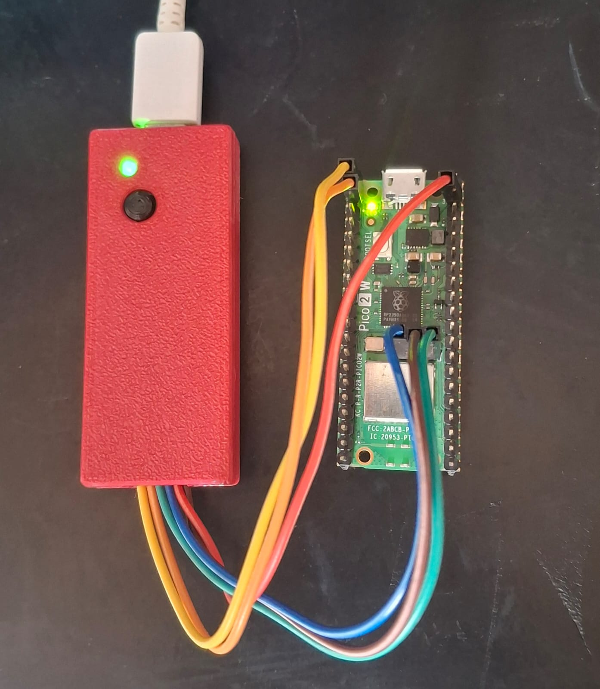
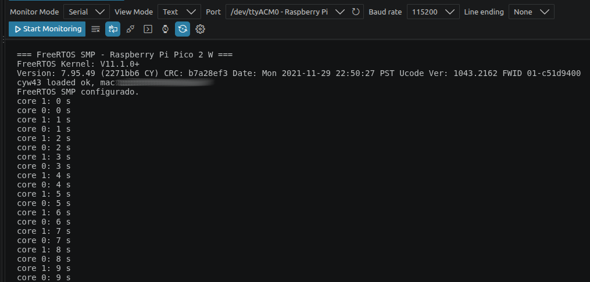

# FreeRTOS SMP on Raspberry Pi Pico 2 W

[Português](README.pt-BR.md) | **English**

This C project uses **FreeRTOS SMP** on the Raspberry Pi Pico 2 W (RP2350), exploring multitasking, core affinity and synchronization between tasks.

A Raspberry Pi Pico (RP2040) is used as a **PicoProbe** for SWD programming and debugging, and UART communication. The Pico 2 W runs the FreeRTOS application.



## Implementation

The application uses three tasks:

| Task | Core | Function |
|---|---|---|
| Counter Task 0 | Core 0 | Execution counter |
| Counter Task 1 | Core 1 | Execution counter |
| LED Task | Core 0 | Controls the onboard LED |

FreeRTOS SMP is enabled for two cores with `configNUMBER_OF_CORES = 2`. Each counter task is pinned to its listed core, and a mutex protects shared UART output. The LED is controlled through the CYW43 interface. The example prints both counters to the serial terminal once per second; it does not implement Wi-Fi or network connectivity.

## Requirements

**Development environment:**
- Ubuntu/Debian
- Git, CMake and Ninja
- GNU Arm Embedded Toolchain
- OpenOCD with RP2350 support
- GDB Multiarch

The scripts use Bash. The Pico SDK and FreeRTOS Kernel are fetched as submodules. The instructions below cover environment setup, building, flashing, serial monitoring and debugging.

**Hardware:**
- Raspberry Pi Pico (RP2040), used as the PicoProbe;
- Raspberry Pi Pico 2 W (RP2350), used as the target;
- USB data cable for the PicoProbe; wires for SWD and GND, plus UART and optional VSYS connections.

The target can be powered by its own USB cable or by the PicoProbe's VSYS output. Do not use both power sources at the same time.

**Optional:** USB cable for independently powering the target; [3D-printed PicoProbe case](https://www.thingiverse.com/thing:5566804).

### PicoProbe enclosure

The [PicoProbe case on Thingiverse](https://www.thingiverse.com/thing:5566804) provides a 3D-printable model for a tidy setup. Printing it is optional; the photo above shows the setup with an enclosure.

## 1. Flash the PicoProbe firmware

On the official [Debug Probe releases](https://github.com/raspberrypi/debugprobe/releases/latest) page, choose the file for the board used **as the probe**:

| Board used as the probe | Firmware |
| --- | --- |
| First-generation Raspberry Pi Pico (RP2040) | `debugprobe_on_pico.uf2` |
| Raspberry Pi Pico 2 (RP2350) | `debugprobe_on_pico2.uf2` |
| Official Raspberry Pi Debug Probe | `debugprobe.uf2` |

This guide uses a **Pico 1** as the probe: download `debugprobe_on_pico.uf2`. The Pico 2 W is the target and receives this project's firmware in the flashing step; do not flash the probe firmware onto it.

1. Disconnect the Pico 1.
2. Hold **BOOTSEL** and connect the Pico 1 to the computer.
3. Copy `debugprobe_on_pico.uf2` to the `RPI-RP2` drive.
4. After reboot, the Pico 1 exposes CMSIS-DAP for SWD and a USB-to-UART serial interface.

## 2. Wire the boards

The diagram illustrates the wiring, including optional target power through VSYS. The board illustrated on the right is a Pico W; for the **Pico 2 W**, identify signals by the names in the table and on the DEBUG header rather than by the board's appearance alone.


| Purpose | Probe pin | Target pin | Connection |
| --- | --- | --- | --- |
| SWD clock | GP2, physical pin 4 | SWCLK on DEBUG header | Probe GP2 → target SWCLK |
| SWD data | GP3, physical pin 5 | SWDIO on DEBUG header | Probe GP3 → target SWDIO |
| Common ground | GND, physical pin 38 | GND on DEBUG header | Probe GND → target GND |
| UART probe TX → target RX | GP4, physical pin 6 | GP1/UART0 RX, physical pin 2 | Optional input to target |
| UART target TX → probe RX | GP5, physical pin 7 | GP0/UART0 TX, physical pin 1 | Required for serial output |
| VSYS power | VSYS, physical pin 39 | VSYS, physical pin 39 | Optional target power |

SWD requires SWCLK, SWDIO and GND. The UART target TX/GP0 → probe RX/GP5 direction is required to see the counters. UART GP4/GP1 is only needed to send data to the target; the example does not process serial commands.

Connect GND first and use 3.3 V logic levels. VSYS power is optional. When VSYS is connected, do not connect a second USB power source to the target.

## 3. Install build tools

The repository scripts use Bash, CMake, Ninja and GNU Arm Embedded tooling. The instructions below are for Ubuntu/Debian.

```bash
sudo apt update
sudo apt install -y build-essential cmake ninja-build git \
  gcc-arm-none-eabi libnewlib-arm-none-eabi \
  libstdc++-arm-none-eabi-newlib libusb-1.0-0-dev gdb-multiarch
```

Clone the repository and initialize the Pico SDK and FreeRTOS Kernel submodules:

```bash
git clone https://github.com/david-embedded-dev/pico2w-freertos-dualcore-counter.git
cd pico2w-freertos-dualcore-counter
git submodule update --init --recursive
```

## 4. Install OpenOCD with RP2350 support

The installed OpenOCD must provide both configuration files:

- `interface/cmsis-dap.cfg`
- `target/rp2350.cfg`

Distribution packages may be too old. The Raspberry Pi [OpenOCD fork](https://github.com/raspberrypi/openocd) includes support for Pico-series boards.

```bash
sudo apt install -y autoconf libtool pkg-config libusb-1.0-0-dev libhidapi-dev

git clone --recurse-submodules https://github.com/raspberrypi/openocd.git "$HOME/raspberrypi-openocd"
(
  cd "$HOME/raspberrypi-openocd"
  ./bootstrap
  ./configure --enable-cmsis-dap
  make -j"$(nproc)"
  sudo make install
)
```

Verify the installation:

```bash
openocd --version
test -f /usr/local/share/openocd/scripts/interface/cmsis-dap.cfg && echo "CMSIS-DAP: OK"
test -f /usr/local/share/openocd/scripts/target/rp2350.cfg && echo "RP2350: OK"
```

These paths correspond to the default `/usr/local` installation. If you use another installation, check its script directory instead. If multiple OpenOCD versions are installed, check `command -v openocd`; `flasher.sh` also accepts an executable path through the `OPENOCD` variable.

## 5. Build

From the repository root:

```bash
./build.sh
```

The script **removes the existing `build/` directory** and creates a clean `Debug` build for `PICO_BOARD=pico2_w` using Ninja. Do not store personal files there. The outputs include:

```text
build/app/pico-freertos.elf
build/app/pico-freertos.uf2
build/app/pico-freertos.bin
```

Manual equivalent:

```bash
cmake -S . -B build -G Ninja \
  -DPICO_BOARD=pico2_w \
  -DCMAKE_BUILD_TYPE=Debug
cmake --build build --parallel "$(nproc)"
```

## 6. Flash through the PicoProbe

Connect the PicoProbe USB cable and complete the SWD and GND wiring. Then run:

```bash
./flasher.sh
```

The script runs OpenOCD with `cmsis-dap.cfg` and `rp2350.cfg`, verifies the ELF in flash, resets the target and exits.

For USB permission issues, configure device permissions, for example with a udev rule appropriate for your distribution.

Manual equivalent:

```bash
openocd \
  -f interface/cmsis-dap.cfg \
  -f target/rp2350.cfg \
  -c "adapter speed 1000" \
  -c "program build/app/pico-freertos.elf verify reset exit"
```

## 7. Open the serial monitor

1. Keep the PicoProbe connected by USB.
2. In VS Code, open a serial monitor extension, or use another serial terminal.
3. Select the PicoProbe CDC/UART port; on Linux it may be `/dev/ttyACM0`.
4. Set **115200 baud, 8 data bits, no parity and 1 stop bit (8N1)** and start monitoring.

The PicoProbe provides CMSIS-DAP for flashing and a CDC port for serial output: select the serial port. USB serial on the Pico 2 W itself is disabled in this firmware; connect the monitor to the **PicoProbe** port. If you missed the startup messages, keep the monitor open and run `./flasher.sh` again in another terminal to flash and reset the target.

Expected output:

```text
=== FreeRTOS SMP - Raspberry Pi Pico 2 W ===
FreeRTOS Kernel: <version>
FreeRTOS SMP configurado.
core 1: 0 s
core 0: 0 s
core 1: 1 s
core 0: 1 s
...
```



The FreeRTOS version and startup logs may vary. Message order is not guaranteed: the important result is that the `core 0` and `core 1` counters keep increasing. Each counter starts at zero when its task starts, after the two-second startup delay.

## Optional: debugging with GDB

Start the OpenOCD server:

```bash
openocd -f interface/cmsis-dap.cfg \
  -f target/rp2350.cfg \
  -c "adapter speed 1000"
```

In another terminal, from the repository root:

```bash
gdb-multiarch build/app/pico-freertos.elf
```

Then use:

```gdb
target extended-remote localhost:3333
monitor reset init
break counter_task
continue
```

Use `continue`, `next` and `step` for normal GDB execution. Before leaving GDB, run `monitor reset run`.

## Continue developing

1. In `app/src/main.c`, follow task creation with `xTaskCreateAffinitySet`, the delays using `vTaskDelayUntil` and the mutex protecting `printf` calls.
2. In `config/FreeRTOSConfig.h`, inspect `configNUMBER_OF_CORES` and `configUSE_CORE_AFFINITY`, which enable the SMP configuration used by the example.
3. Modify or add a task in `app/src/main.c`, build with `./build.sh` and flash with `./flasher.sh`. Use the serial monitor and GDB to observe its behavior.

## Troubleshooting

- **Missing submodule:** from the project root, run `git submodule update --init --recursive` and make sure it completes without errors.
- **OpenOCD cannot find `rp2350.cfg`:** check the version and script directory of the selected OpenOCD; install a version with RP2350 support.
- **SWD connection or flashing fails:** check target power, common ground, SWCLK and SWDIO. Also check USB permissions for the PicoProbe.
- **No serial output or garbled text:** check the PicoProbe CDC port, target GP0 → probe GP5, common ground and 115200/8N1. On Linux, check serial port permissions.
- **Missing startup messages:** open the monitor before resetting the target; the firmware does not wait for the monitor to connect.

## Project structure

| Path | Purpose |
| --- | --- |
| `app/src/main.c` | CYW43 initialization, LED task and core-pinned counter tasks |
| `app/CMakeLists.txt` | Executable, libraries, UART baud rate and generated outputs |
| `config/FreeRTOSConfig.h` | SMP scheduler, core affinity and kernel settings |
| `CMakeLists.txt` | Pico SDK, Pico 2 W target and FreeRTOS RP2350 port |
| `build.sh` | Clean Debug build |
| `flasher.sh` | ELF flashing and verification through OpenOCD |

## References

- [Raspberry Pi Debug Probe documentation](https://www.raspberrypi.com/documentation/microcontrollers/debug-probe.html)
- [Debug Probe firmware releases](https://github.com/raspberrypi/debugprobe/releases)
- [Raspberry Pi Pico SDK](https://github.com/raspberrypi/pico-sdk)
- [FreeRTOS Kernel](https://github.com/FreeRTOS/FreeRTOS-Kernel)
- [Raspberry Pi OpenOCD fork](https://github.com/raspberrypi/openocd)
- [PicoProbe enclosure](https://www.thingiverse.com/thing:5566804)

## License

The original project files are licensed under the [MIT License](LICENSE). Pico SDK, FreeRTOS and the third-party enclosure retain their respective licenses.
