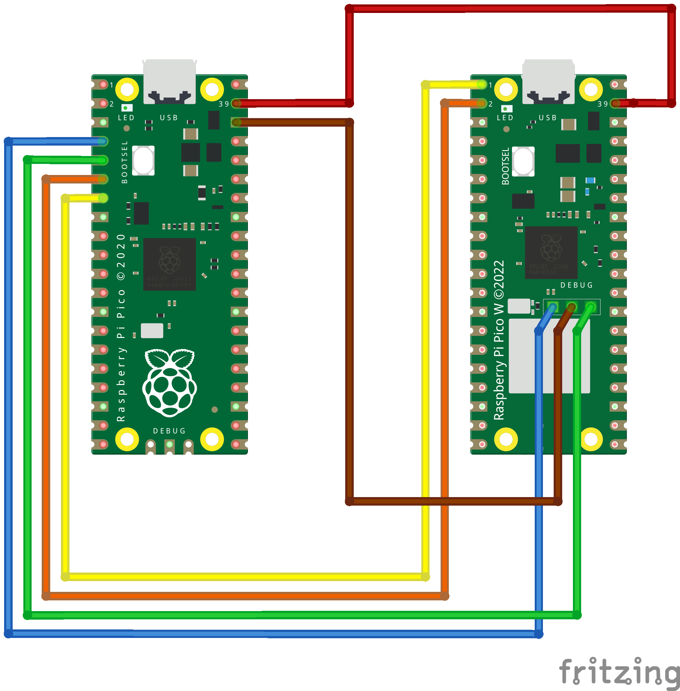

# FreeRTOS SMP on Raspberry Pi Pico 2 W

**English** | [Português](README.pt-BR.md)

A C project with **FreeRTOS SMP** on the Raspberry Pi Pico 2 W (RP2350), exploring multitasking, core affinity and synchronization between tasks.

A Raspberry Pi Pico (RP2040) is used as a **PicoProbe** for SWD programming and debugging, and UART communication.


## Implementation

The application uses three tasks:

| Task | Core | Function |
|---|---|---|
| Counter Task 0 | Core 0 | Execution counter |
| Counter Task 1 | Core 1 | Execution counter |
| LED Task | Core 0 | Controls the onboard LED |

UART access is protected by a mutex. The LED is controlled through the CYW43 interface.

## Requirements

**Development environment:**
- Ubuntu/Debian
- Git, CMake and Ninja
- GNU Arm Embedded Toolchain
- OpenOCD with RP2350 support
- GDB Multiarch

The scripts use Bash. The Pico SDK and FreeRTOS Kernel are fetched as submodules.

**Hardware:**
- Raspberry Pi Pico (RP2040), used as the PicoProbe;
- Raspberry Pi Pico 2 W (RP2350), used as the target;
- USB data cable and wires for SWD, UART and GND.

The target can be powered by USB or by the PicoProbe's VSYS output. Do not use both power sources at the same time.

**Optional:** [3D-printed PicoProbe case](https://www.thingiverse.com/thing:5566804).

## 1. Flash the PicoProbe firmware

On the official [Debug Probe releases](https://github.com/raspberrypi/debugprobe/releases/latest) page, choose the file for the board used **as the probe**:

| Board used as the probe | Firmware |
| --- | --- |
| First-generation Raspberry Pi Pico (RP2040) | `debugprobe_on_pico.uf2` |
| Raspberry Pi Pico 2 (RP2350) | `debugprobe_on_pico2.uf2` |
| Official Raspberry Pi Debug Probe | `debugprobe.uf2` |

This guide uses a **Pico 1** as the probe: download `debugprobe_on_pico.uf2`. The Pico 2 W is the target and receives this project's firmware in the flashing step; do not flash the probe firmware onto it.

1. Disconnect the Pico 1.
2. Hold **BOOTSEL** and connect the Pico 1 to the computer.
3. Copy `debugprobe_on_pico.uf2` to the `RPI-RP2` drive.
4. After reboot, the Pico 1 provides CMSIS-DAP for SWD and a USB-to-UART serial interface.

## 2. Wire the boards

The Pico W on the left represents the Pico 2 W due to their identical pinout.



| Purpose | Probe pin | Target pin | Connection |
| --- | --- | --- | --- |
| SWD clock | GP2, physical pin 4 | SWCLK on DEBUG header | Probe GP2 → target SWCLK |
| SWD data | GP3, physical pin 5 | SWDIO on DEBUG header | Probe GP3 → target SWDIO |
| Common ground | GND, physical pin 38 | GND on DEBUG header | Probe GND → target GND |
| UART probe TX → target RX | GP4, physical pin 6 | GP1/UART0 RX, physical pin 2 | Optional input to target |
| UART target TX → probe RX | GP5, physical pin 7 | GP0/UART0 TX, physical pin 1 | Required for serial output |
| VSYS power | VSYS, physical pin 39 | VSYS, physical pin 39 | Optional target power |

SWD requires SWCLK, SWDIO and GND. The UART target TX/GP0 → probe RX/GP5 direction is required to see the counters. UART GP4/GP1 is only needed to send data to the target; the example does not process serial commands.

Connect GND first and use 3.3 V logic levels. VSYS power is optional. When VSYS is connected, do not connect a second USB power source to the target.

## 3. Install build tools

The scripts use Bash, CMake, Ninja and GNU Arm Embedded tools. The commands below are for Ubuntu/Debian:

```bash
sudo apt update
sudo apt install -y build-essential cmake ninja-build git \
  gcc-arm-none-eabi libnewlib-arm-none-eabi \
  libstdc++-arm-none-eabi-newlib libusb-1.0-0-dev gdb-multiarch
```

Clone the repository and initialize the Pico SDK and FreeRTOS Kernel submodules:

```bash
git clone https://github.com/david-embedded-dev/pico2w-freertos-dualcore-counter.git
cd pico2w-freertos-dualcore-counter
git submodule update --init --recursive
```

## 4. Install OpenOCD with RP2350 support

The installed OpenOCD must provide these two files:

- `interface/cmsis-dap.cfg`
- `target/rp2350.cfg`

Older distribution packages may not support the RP2350. The Raspberry Pi [OpenOCD fork](https://github.com/raspberrypi/openocd) includes support for Pico-series boards.

```bash
sudo apt install -y autoconf libtool pkg-config libusb-1.0-0-dev libhidapi-dev

git clone --recurse-submodules https://github.com/raspberrypi/openocd.git "$HOME/raspberrypi-openocd"
(
  cd "$HOME/raspberrypi-openocd"
  ./bootstrap
  ./configure --enable-cmsis-dap
  make -j"$(nproc)"
  sudo make install
)
```

Verify the installation:

```bash
openocd --version
test -f /usr/local/share/openocd/scripts/interface/cmsis-dap.cfg && echo "CMSIS-DAP: OK"
test -f /usr/local/share/openocd/scripts/target/rp2350.cfg && echo "RP2350: OK"
```

These paths correspond to the default installation in `/usr/local`. If you use another installation, check the files in its scripts directory. If more than one OpenOCD version is installed, check `command -v openocd`; `flasher.sh` also accepts the executable path through the `OPENOCD` variable.

## 5. Build

From the repository root:

```bash
./build.sh
```

The script **removes the existing `build/` directory** and creates a clean `Debug` build for `PICO_BOARD=pico2_w` using Ninja. Do not store personal files in this directory. The generated files include:

```text
build/app/pico-freertos.elf
build/app/pico-freertos.uf2
build/app/pico-freertos.bin
```

Manual equivalent:

```bash
cmake -S . -B build -G Ninja \
  -DPICO_BOARD=pico2_w \
  -DCMAKE_BUILD_TYPE=Debug
cmake --build build --parallel "$(nproc)"
```

## 6. Flash through the PicoProbe

Connect the PicoProbe USB cable and complete the SWD and GND wiring. Then run:

```bash
./flasher.sh
```

The script uses OpenOCD with `cmsis-dap.cfg` and `rp2350.cfg`, verifies the ELF in flash, resets the target and exits.

If you get a USB access error, configure device permissions, for example with a udev rule appropriate for your distribution.

Manual equivalent:

```bash
openocd \
  -f interface/cmsis-dap.cfg \
  -f target/rp2350.cfg \
  -c "adapter speed 1000" \
  -c "program build/app/pico-freertos.elf verify reset exit"
```

## 7. Open the serial monitor

1. Keep the PicoProbe connected to the computer by USB.
2. In VS Code, open a serial monitor extension or use another terminal program.
3. Select the PicoProbe CDC/UART port; on Linux, it may be `/dev/ttyACM0`.
4. Set **115200 baud, 8 data bits, no parity and 1 stop bit (8N1)** and start monitoring.

The PicoProbe provides CMSIS-DAP for flashing and a CDC port for serial output; select the serial port. USB serial on the Pico 2 W itself is disabled in this firmware; connect the monitor to the **PicoProbe** port. If you missed the startup messages, keep the monitor open and run `./flasher.sh` again in another terminal to flash and reset the target.

Expected output:


The FreeRTOS version and startup logs may vary. Message order is not guaranteed: the important result is that the `core 0` and `core 1` counters keep increasing. Each counter starts at zero when its task starts, after the two-second startup delay.

## Continue developing

- Explore task creation in `app/src/main.c`.
- Check `config/FreeRTOSConfig.h` to adjust SMP settings and core affinity.
- After making changes, build with `./build.sh` and flash with `./flasher.sh`.

## Troubleshooting

- **Submodules:** run `git submodule update --init --recursive`.
- **OpenOCD:** confirm that the installation supports RP2350 and can find `rp2350.cfg`.
- **SWD flashing:** check power, common GND, SWCLK, SWDIO and PicoProbe USB permissions.
- **No serial output:** check the PicoProbe CDC port, UART connections, GND and 115200/8N1 settings.
- **Missing startup messages:** open the serial monitor before resetting the board.

## Project structure

| Path | Purpose |
|---|---|
| `app/src/main.c` | CYW43 initialization and task implementation |
| `app/CMakeLists.txt` | Executable and library configuration |
| `config/FreeRTOSConfig.h` | FreeRTOS SMP configuration |
| `CMakeLists.txt` | Pico SDK and project configuration |
| `build.sh` | Firmware build |
| `flasher.sh` | Firmware flashing and verification |

## References

- [Raspberry Pi Debug Probe documentation](https://www.raspberrypi.com/documentation/microcontrollers/debug-probe.html)
- [Debug Probe firmware releases](https://github.com/raspberrypi/debugprobe/releases)
- [Raspberry Pi Pico SDK](https://github.com/raspberrypi/pico-sdk)
- [FreeRTOS Kernel](https://github.com/FreeRTOS/FreeRTOS-Kernel)
- [Raspberry Pi OpenOCD fork](https://github.com/raspberrypi/openocd)
- [PicoProbe case](https://www.thingiverse.com/thing:5566804)

## License

The original project files are licensed under the [MIT License](LICENSE). Pico SDK, FreeRTOS and the third-party case retain their respective licenses.
