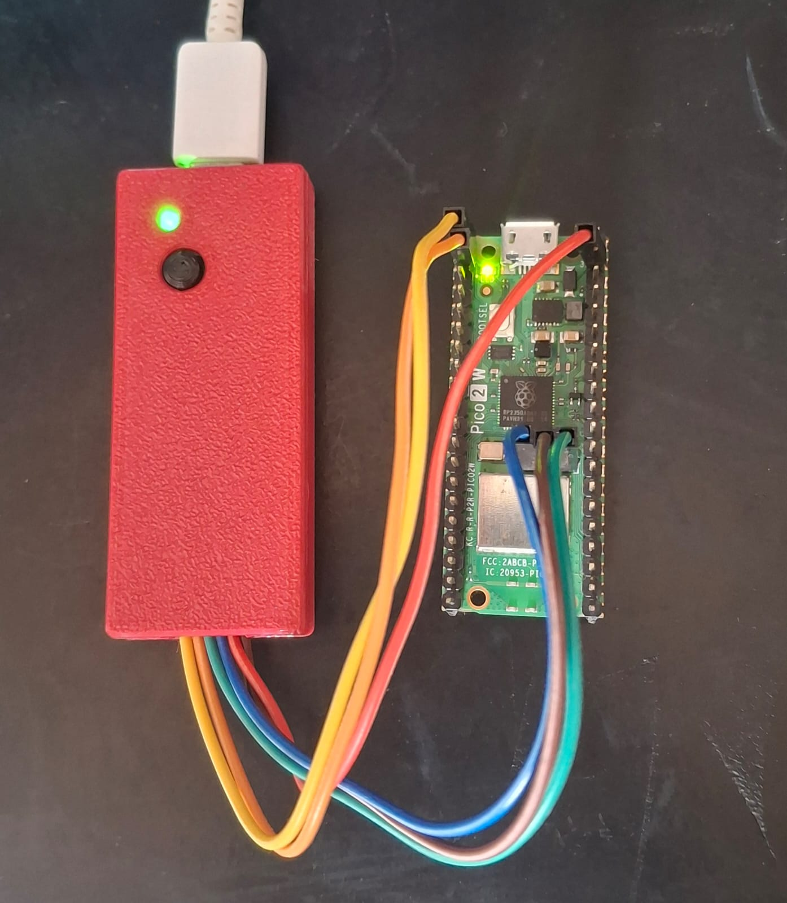
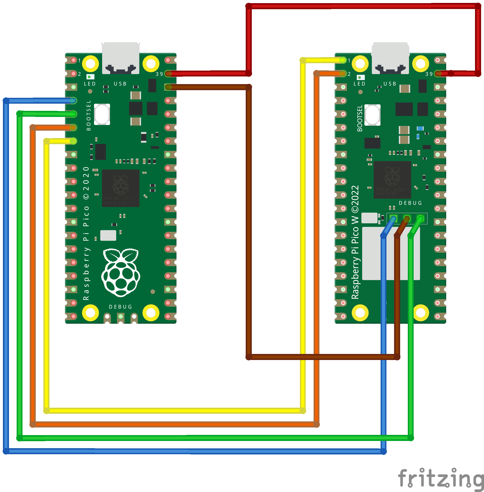
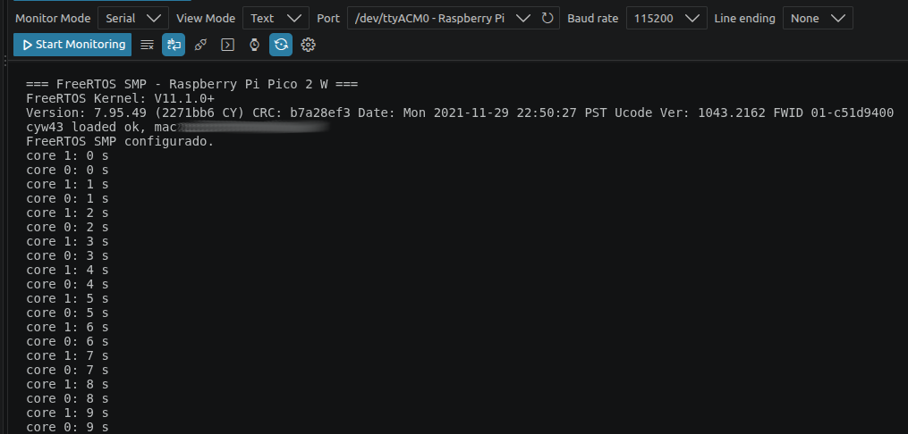

# FreeRTOS SMP na Raspberry Pi Pico 2 W com PicoProbe

[English](README.md) | **Português**



*Montagem de teste: a PicoProbe vermelha grava e depura a Pico 2 W, que executa o firmware FreeRTOS.*

Este projeto demonstra uma configuração inicial do **FreeRTOS SMP** na **Raspberry Pi Pico 2 W (RP2350)**. Uma **Raspberry Pi Pico de primeira geração (RP2040)** executa o firmware Debug Probe e atua como PicoProbe: ela fornece depuração/gravação SWD e uma ponte serial UART via USB.

O firmware cria duas tarefas, uma fixada em cada núcleo da Pico 2 W, e mostra seus contadores pelo monitor serial. O projeto é experimental e voltado a aprendizado e testes de bring-up de firmware embarcado.

> **Placas usadas:** a Pico 1 funciona como probe; a Pico 2 W é o alvo que executa o FreeRTOS. O firmware deste repositório está configurado para RP2350/Pico 2 W.

## Visão geral

1. Gravar o firmware Debug Probe na Pico 1.
2. Conectar SWD, UART e, opcionalmente, VSYS conforme a tabela de ligações.
3. Compilar o firmware FreeRTOS para Pico 2 W.
4. Gravar e depurar o ELF pela PicoProbe com OpenOCD.
5. Acompanhar os dois núcleos pelo monitor serial do VS Code.

## Hardware necessário

- Raspberry Pi Pico de primeira geração (RP2040), usada como PicoProbe;
- Raspberry Pi Pico 2 W (RP2350), usada como alvo;
- cabo USB de dados para a PicoProbe;
- jumpers para SWD, UART e, se desejado, alimentação por VSYS.

## 1. Preparar a PicoProbe

Baixe `debugprobe_on_pico.uf2` na página de [releases oficiais do firmware Debug Probe](https://github.com/raspberrypi/debugprobe/releases). Esse arquivo é para uma Pico de primeira geração. Não use `debugprobe.uf2`, que se destina ao Debug Probe oficial.

1. Desconecte a Pico 1 do USB.
2. Mantenha **BOOTSEL** pressionado enquanto conecta a placa ao computador.
3. Quando o volume `RPI-RP2` aparecer, copie `debugprobe_on_pico.uf2` para ele.
4. A Pico reinicia e passa a oferecer CMSIS-DAP para SWD e uma ponte USB-UART.

## 2. Ligações entre debugger e target

A imagem mostra a montagem e o caminho dos seis cabos coloridos. As cores abaixo seguem o diagrama: **VM** vermelho, **MR** marrom, **VD** verde, **LJ** laranja, **AZ** azul e **AM** amarelo.



| Função | Cor do cabo | Pino no Pico debugger (PicoProbe) | Pino no Pico 2 W (target) | Observação |
| --- | --- | --- | --- | --- |
| SWCLK (clock SWD) | Azul | GP2 (pino físico 4) | SWCLK (header DEBUG) | Clock da depuração SWD |
| SWDIO (dados SWD) | Verde | GP3 (pino físico 5) | SWDIO (header DEBUG) | Dados bidirecionais da depuração |
| GND (terra) |Marrom | GND (pino físico 38) | GND ( header DEBUG) | Referência elétrica comum |
| UART TX → RX | Laranja | GP4 (pino físico 6) | GP1 (pino físico 2, UART0 RX) | Envia dados ao target |
| UART RX ← TX | Amarelo | GP5 (pino físico 7) | GP0 (pino físico 1, UART0 TX) | Recebe o dados do target |
| Alimentação VSYS | Vermelho | VSYS (pino físico 39) | VSYS (pino físico 39) | Alimenta o target pela PicoProbe |

SWD precisa de **SWCLK, SWDIO e GND**. Para apenas receber os logs, conecte também o UART TX da Pico 2 W (GP0) ao UART RX da PicoProbe (GP5). GP4/GP1 só é necessário se o computador também for enviar dados à Pico 2 W.

Conecte o GND comum antes dos sinais. Os sinais de GPIO são de 3,3 V. A ligação vermelha de VSYS é opcional; se alimentar a Pico 2 W por VSYS, não conecte simultaneamente outra fonte USB de alimentação ao target.

### Gabinete impresso em 3D

O gabinete usado para a PicoProbe pode ser impresso em 3D. Os arquivos do modelo estão no [Thingiverse — PicoProbe case](https://www.thingiverse.com/thing:5566804).

## 3. Dependências de compilação

Os comandos abaixo são para Ubuntu/Debian:

```bash
sudo apt update
sudo apt install -y build-essential cmake ninja-build git \
  gcc-arm-none-eabi libnewlib-arm-none-eabi \
  libstdc++-arm-none-eabi-newlib libusb-1.0-0-dev gdb-multiarch
```

O Pico SDK e o FreeRTOS Kernel estão configurados como submódulos em `libs/`. Na raiz do repositório, inicialize-os se necessário:

```bash
git submodule update --init --recursive
```

### OpenOCD com suporte a RP2350

O OpenOCD precisa incluir `interface/cmsis-dap.cfg` e `target/rp2350.cfg`. Algumas distribuições fornecem uma versão antiga; a versão mantida pela Raspberry Pi está no [repositório raspberrypi/openocd](https://github.com/raspberrypi/openocd).

Para compilar e instalar no Ubuntu/Debian:

```bash
sudo apt install -y autoconf libtool pkg-config libusb-1.0-0-dev libhidapi-dev
git clone --recurse-submodules https://github.com/raspberrypi/openocd.git
cd openocd
./bootstrap
./configure --enable-cmsis-dap
make -j"$(nproc)"
sudo make install
```

Confira a instalação e se o script do alvo RP2350 está disponível:

```bash
openocd --version
find /usr/share/openocd /usr/local/share/openocd -path '*/target/rp2350.cfg' 2>/dev/null
```

## 4. Compilar o firmware FreeRTOS

Na raiz deste repositório:

```bash
./build.sh
```

O script configura `PICO_BOARD=pico2_w`, seleciona o build `Debug` e compila usando Ninja. Ele remove o diretório `build/` antes de compilar. O ELF usado para gravação e depuração fica em `build/app/pico-freertos.elf`.

Também é possível configurar e compilar manualmente:

```bash
cmake -S . -B build -G Ninja \
  -DPICO_BOARD=pico2_w \
  -DCMAKE_BUILD_TYPE=Debug
cmake --build build --parallel "$(nproc)"
```

O programa mantém o LED da Pico 2 W piscando e executa duas tarefas FreeRTOS com afinidade fixa: contador no core 0 e contador no core 1. A saída UART é configurada para **115200 baud, 8N1**.

## 5. Gravar pela PicoProbe

Com a PicoProbe conectada por USB ao computador e os fios SWD conectados ao target, execute:

```bash
./flasher.sh
```

O script usa OpenOCD para gravar `build/app/pico-freertos.elf`, verificar o conteúdo da flash e reiniciar a Pico 2 W. Se houver erro de permissão USB, tente `sudo ./flasher.sh`.

O comando equivalente é:

```bash
openocd \
  -f interface/cmsis-dap.cfg \
  -f target/rp2350.cfg \
  -c "adapter speed 1000" \
  -c "program build/app/pico-freertos.elf verify reset exit"
```

## 6. Monitor serial e resultado

No VS Code, abra uma extensão de monitor serial, selecione a porta CDC da PicoProbe — no Linux costuma ser `/dev/ttyACM0` — e configure **115200 baud**. Conecte o monitor antes de energizar a placa para capturar desde o banner inicial.

O firmware apresenta o nome do projeto e a versão do FreeRTOS no início. Em seguida, inicializa o CYW43, informa que os contadores começarão em 2 segundos e mostra as contagens dos dois cores. O endereço MAC exibido em execução foi ocultado na imagem abaixo.



O valor `core` vem do núcleo onde a tarefa está executando. A alternância de `core 0` e `core 1` demonstra as tarefas distribuídas nos dois núcleos do RP2350.

## 7. Depuração interativa com GDB

Depois de gravar o firmware, inicie o servidor OpenOCD em um terminal:

```bash
openocd -f interface/cmsis-dap.cfg \
  -f target/rp2350.cfg \
  -c "adapter speed 1000"
```

Em outro terminal, na raiz do repositório, abra o ELF no GDB:

```bash
gdb-multiarch build/app/pico-freertos.elf
```

No prompt do GDB:

```gdb
target extended-remote localhost:3333
monitor reset init
break counter_task
continue
```

Use `continue`, `next` e `step` para continuar ou avançar pelo código. Antes de encerrar o GDB, execute `monitor reset run` para deixar o target em execução.

## Estrutura principal do projeto

| Caminho | Descrição |
| --- | --- |
| `app/src/main.c` | Inicialização, LED e tarefas contadoras nos dois cores |
| `app/CMakeLists.txt` | Bibliotecas do aplicativo e configuração da UART |
| `config/FreeRTOSConfig.h` | Configuração SMP e do kernel FreeRTOS |
| `CMakeLists.txt` | Pico SDK e port FreeRTOS para RP2350 |
| `build.sh` | Configuração e compilação `Debug` |
| `flasher.sh` | Gravação e verificação via OpenOCD |
| `images/` | Fotos da montagem, diagrama de ligação e captura serial |

## Licença

O código-fonte original e a documentação do projeto estão licenciados sob a [licença MIT](LICENSE). Dependências e materiais de terceiros mantêm suas próprias licenças; consulte os avisos nos respectivos repositórios e diretórios.

## Referências

- [Firmware Debug Probe — releases](https://github.com/raspberrypi/debugprobe/releases)
- [Documentação Raspberry Pi Debug Probe](https://www.raspberrypi.com/documentation/microcontrollers/debug-probe.html)
- [OpenOCD da Raspberry Pi](https://github.com/raspberrypi/openocd)
- [Pico SDK](https://github.com/raspberrypi/pico-sdk)
- [FreeRTOS Kernel](https://github.com/FreeRTOS/FreeRTOS-Kernel)
- [Gabinete PicoProbe para impressão 3D no Thingiverse](https://www.thingiverse.com/thing:5566804)
