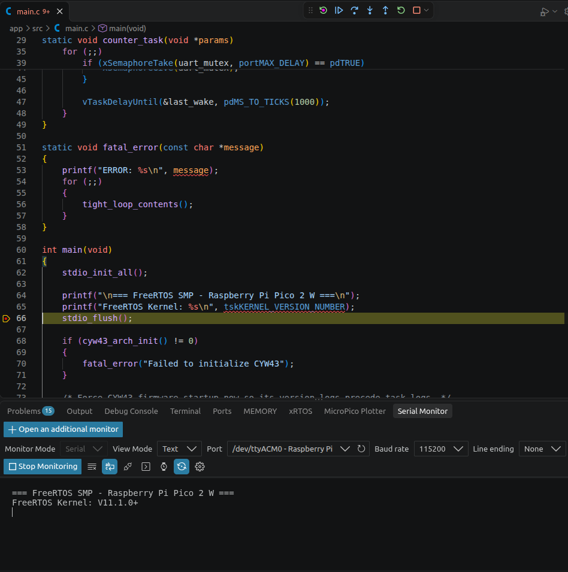

# FreeRTOS SMP na Raspberry Pi Pico 2 W

**Português** | [English](README.md)

Projeto em C com **FreeRTOS SMP** na Raspberry Pi Pico 2 W (RP2350), explorando multitarefa, afinidade de núcleo (*Core Affinity*) e sincronização entre tarefas.


## Implementação

A aplicação utiliza três tarefas:

| Tarefa | Núcleo | Função |
|---|---|---|
| Counter Task 0 | Core 0 | Contador de execução |
| Counter Task 1 | Core 1 | Contador de execução |
| LED Task | Core 0 | Controle do LED integrado |

O acesso à UART é protegido por Mutex. O LED é controlado pela interface CYW43.

## Requisitos

**Software**
- Ubuntu/Debian
- Visual Studio Code
- Git, CMake e Ninja
- GNU Arm Embedded Toolchain
- OpenOCD com suporte ao RP2350
- `gdb-multiarch` (ou `arm-none-eabi-gdb`)
- Extensão Cortex-Debug no VS Code

Os scripts utilizam Bash. O Pico SDK e o FreeRTOS Kernel são obtidos como submódulos.

**Hardware:**
- Raspberry Pi Pico (RP2040), como PicoProbe;
- Raspberry Pi Pico 2 W (RP2350), como placa-alvo;
- Cabo USB de dados e fios para SWD, UART e GND.

A placa-alvo pode ser alimentada por USB ou pela saída VSYS da PicoProbe. Não utilize as duas fontes simultaneamente.

**Opcional:** [case impresso em 3D para a PicoProbe](https://www.thingiverse.com/thing:5566804).

## 1. Gravar o firmware da PicoProbe

Na página oficial de [releases do Debug Probe](https://github.com/raspberrypi/debugprobe/releases/latest), escolha o arquivo conforme a placa usada **como probe**:

| Placa usada como probe | Firmware |
| --- | --- |
| Raspberry Pi Pico de primeira geração (RP2040) | `debugprobe_on_pico.uf2` |
| Raspberry Pi Pico 2 (RP2350) | `debugprobe_on_pico2.uf2` |
| Raspberry Pi Debug Probe oficial | `debugprobe.uf2` |

Neste guia, a probe é uma **Pico 1**: baixe `debugprobe_on_pico.uf2`. A Pico 2 W é o alvo e receberá o firmware deste projeto na etapa de gravação; não grave nela o firmware da probe.

1. Desconecte a Pico 1.
2. Mantenha **BOOTSEL** pressionado e conecte a Pico 1 ao computador.
3. Copie `debugprobe_on_pico.uf2` para a unidade `RPI-RP2`.
4. Após reiniciar, a Pico 1 oferece CMSIS-DAP para SWD e uma interface serial USB-UART.

## 2. Conectar as placas

A placa Pico W à esquerda representa a Pico 2 W, pois ambas possuem a mesma pinagem.


| Finalidade | Pino da probe | Pino do alvo | Ligação |
| --- | --- | --- | --- |
| Clock SWD | GP2, pino físico 4 | SWCLK no header DEBUG | Probe GP2 → alvo SWCLK |
| Dados SWD | GP3, pino físico 5 | SWDIO no header DEBUG | Probe GP3 → alvo SWDIO |
| Terra comum | GND, pino físico 38 | GND no header DEBUG | Probe GND → alvo GND |
| UART TX da probe → RX do alvo | GP4, pino físico 6 | GP1/UART0 RX, pino físico 2 | Entrada opcional no alvo |
| UART TX do alvo → RX da probe | GP5, pino físico 7 | GP0/UART0 TX, pino físico 1 | Necessária para os logs |
| Alimentação VSYS | VSYS, pino físico 39 | VSYS, pino físico 39 | Alimentação opcional do alvo |

## 3. Setup do ambiente

Os scripts usam Bash, CMake, Ninja e ferramentas GNU Arm Embedded. Os comandos abaixo são para Ubuntu/Debian:

```bash
sudo apt update
sudo apt install -y build-essential cmake ninja-build git \
  gcc-arm-none-eabi libnewlib-arm-none-eabi \
  libstdc++-arm-none-eabi-newlib libusb-1.0-0-dev gdb-multiarch
```

Clone o repositório e inicialize os submódulos Pico SDK e FreeRTOS Kernel:

```bash
git clone https://github.com/david-embedded-dev/pico2w-freertos-smp.git
cd pico2w-freertos-smp
git submodule update --init --recursive
```

## 4. Instalar OpenOCD com suporte a RP2350

O OpenOCD instalado precisa fornecer estes dois arquivos:

- `interface/cmsis-dap.cfg`
- `target/rp2350.cfg`

Pacotes antigos das distribuições podem não suportar o RP2350. O [fork OpenOCD da Raspberry Pi](https://github.com/raspberrypi/openocd) inclui suporte às placas Pico.

```bash
sudo apt install -y autoconf libtool pkg-config libusb-1.0-0-dev libhidapi-dev

git clone --recurse-submodules https://github.com/raspberrypi/openocd.git "$HOME/raspberrypi-openocd"
(
  cd "$HOME/raspberrypi-openocd"
  ./bootstrap
  ./configure --enable-cmsis-dap
  make -j"$(nproc)"
  sudo make install
)
```

Confira a instalação:

```bash
openocd --version
test -f /usr/local/share/openocd/scripts/interface/cmsis-dap.cfg && echo "CMSIS-DAP: OK"
test -f /usr/local/share/openocd/scripts/target/rp2350.cfg && echo "RP2350: OK"
```


## 5. Compilar

Na raiz do repositório:

```bash
./build.sh
```

O script **remove o diretório `build/` existente** e cria uma compilação limpa em modo `Debug` para `PICO_BOARD=pico2_w`, usando Ninja. Os arquivos gerados incluem:

```text
build/app/pico-freertos.elf
build/app/pico-freertos.uf2
build/app/pico-freertos.bin
```

## 6. Gravar pela PicoProbe

Conecte o cabo USB da PicoProbe e complete as ligações SWD e GND. Em seguida:

```bash
./flasher.sh
```

O script usa o OpenOCD com `cmsis-dap.cfg` e `rp2350.cfg`, verifica o ELF na flash, reinicia o alvo e encerra.

## 7. Monitor serial

Para receber os logs, instale e abra [Serial Monitor](https://marketplace.visualstudio.com/items?itemName=ms-vscode.vscode-serial-monitor) ou use outro terminal serial. Selecione a porta CDC/UART da probe (geralmente `/dev/ttyACM0` no Linux) e configure **115200 baud, 8N1**.

A USB serial da própria Pico 2 W está desabilitada neste firmware; selecione a porta da **PicoProbe**, não a do alvo. Se perdeu as mensagens iniciais, abra o monitor primeiro e reinicie a placa com `./flasher.sh` em outro terminal.

Saída esperada:


## 8. Debug

 Para debugar são necessários uma PicoProbe (ou outra sonda CMSIS-DAP), OpenOCD com suporte a RP2350 e gdb-multiarch e a extensão de depuração do VS Code Cortex-Debug.

Em **Run and Debug**, selecione **Pico 2 W via Pico Probe** e clique em iniciar, insira breakpoints e teste, a saída esperada é mostrada abaixo:
<p align="center">
  
</p>

*Depuração da Pico 2 W via PicoProbe no VS Code.*


## Continue desenvolvendo

- Explore a criação de tarefas em `app/src/main.c`.
- Consulte `config/FreeRTOSConfig.h` para ajustar as configurações SMP e a afinidade dos núcleos.
- Após as alterações, compile com `./build.sh` e grave com `./flasher.sh`.

## Solução de problemas

- **Submódulos:** execute `git submodule update --init --recursive`.
- **OpenOCD:** confirme que a instalação possui suporte ao RP2350 e localiza `rp2350.cfg`.
- **Gravação SWD:** verifique alimentação, GND comum, SWCLK, SWDIO e permissões USB da PicoProbe.
- **Serial sem saída:** confira a porta CDC da PicoProbe, as conexões UART, o GND e a configuração 115200/8N1.
- **Mensagens iniciais ausentes:** abra o monitor serial antes de reiniciar a placa.


## Referências

- [Documentação Raspberry Pi Debug Probe](https://www.raspberrypi.com/documentation/microcontrollers/debug-probe.html)
- [Releases do firmware Debug Probe](https://github.com/raspberrypi/debugprobe/releases)
- [Raspberry Pi Pico SDK](https://github.com/raspberrypi/pico-sdk)
- [FreeRTOS Kernel](https://github.com/FreeRTOS/FreeRTOS-Kernel)
- [OpenOCD da Raspberry Pi](https://github.com/raspberrypi/openocd)
- [Case para PicoProbe](https://www.thingiverse.com/thing:5566804)

## Licença

Os arquivos originais deste projeto estão licenciados sob a [Licença MIT](LICENSE). Pico SDK, FreeRTOS e o case de terceiros mantêm suas respectivas licenças.
